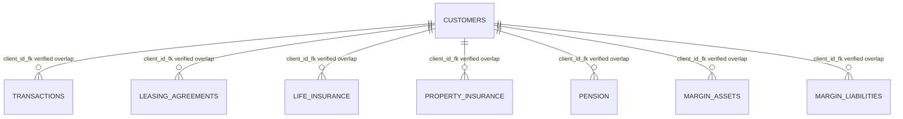

# CashFlowAI Comprehensive Dataset Analysis

## Executive Summary

The dataset contains 130,614,687 rows and 81 columns across eight Parquet files. The record-level scan confirms that `transactions` is the only table directly suitable for constructing bank-transaction cash flow, while `customers` is essential for cohort identification.

The material SME limitation is confirmed: all 200,000 customer rows are labelled `Private`, with no SME or Corporate labels. No other schema contains a segment field. Transactions were scanned for general quality and relationship coverage, but this cannot create an authoritative SME label.

The transaction customer reference joins to the customer identifier for 120,926,662 of 120,926,662 non-null transactions, with 0 orphan transaction rows.

## Dataset-wide Overview

| Table | Rows | Columns | Row groups | File size (bytes) | Classification |
| --- | ---: | ---: | ---: | ---: | --- |
| `customers` | 200,000 | 13 | 2 | 4,227,635 | customer master data |
| `transactions` | 120,926,662 | 20 | 989 | 3,347,559,295 | transaction event history |
| `leasing_agreements` | 116,660 | 9 | 1 | 2,075,564 | monthly agreement snapshots |
| `life_insurance` | 592,381 | 8 | 6 | 4,479,430 | monthly insurance-policy snapshots |
| `property_insurance` | 1,012,945 | 8 | 9 | 11,558,891 | monthly insurance-policy snapshots |
| `pension` | 2,966,040 | 7 | 25 | 27,708,082 | periodic pension contribution records |
| `margin_assets` | 4,561,521 | 8 | 58 | 112,363,012 | monthly positive-balance snapshots |
| `margin_liabilities` | 238,478 | 8 | 4 | 6,016,103 | monthly liability-balance snapshots |

## Relationship Matrix

| Source | Target | Matching rows | Orphan rows | Null references | Distinct references | Verified | Cardinality / risk |
| --- | --- | ---: | ---: | ---: | ---: | --- | --- |
| transactions.client_id_fk | customers.client_id | 120,926,662 | 0 | 0 | 200000 | True | Customer joins may multiply rows because each customer can have multiple records. |
| leasing_agreements.client_id_fk | customers.client_id | 116,660 | 0 | 0 | 17898 | True | Customer joins may multiply rows because each customer can have multiple records. |
| life_insurance.client_id_fk | customers.client_id | 592,381 | 0 | 0 | 43994 | True | Customer joins may multiply rows because each customer can have multiple records. |
| property_insurance.client_id_fk | customers.client_id | 1,012,945 | 0 | 0 | 69886 | True | Customer joins may multiply rows because each customer can have multiple records. |
| pension.client_id_fk | customers.client_id | 2,966,040 | 0 | 0 | 123585 | True | Customer joins may multiply rows because each customer can have multiple records. |
| margin_assets.client_id_fk | customers.client_id | 4,561,521 | 0 | 0 | 199734 | True | Customer joins may multiply rows because each customer can have multiple records. |
| margin_liabilities.client_id_fk | customers.client_id | 238,478 | 0 | 0 | 37234 | True | Customer joins may multiply rows because each customer can have multiple records. |

The customer join is structurally verified from exact aggregate overlap. It is not safe to join snapshot tables directly to transactions without period alignment and aggregation because all non-customer tables can contain many rows per customer.

## Mermaid ER Diagram

No agreement, policy or account dimension table is present. Product contract identifiers and transaction-account relationships therefore remain unresolved.

### Candidate-key status

- `customers.client_id`: verified unique and non-null in the scanned 200,000-row file.
- `transactions.txn_id`: identifier candidate only; exact global uniqueness was deferred because retaining all transaction IDs would exceed the bounded-memory policy.
- Snapshot tables: `(client_id_fk, reporting date)` is a practical period key candidate, but it cannot identify individual contracts because agreement/policy identifiers are absent. Exact duplicate tests are reported below where cardinality permitted.

## SME Discrepancy Investigation

### Verified Segment Evidence

- Observed segment distribution: Private (200,000).
- Null segment rows: 0.
- `segment` exists only in `customers.parquet` among the eight tables.

### Customer-reference Evidence

| Source table | Distinct references | Orphan references | Orphan rows | Verified coverage |
| --- | ---: | ---: | ---: | --- |
| `transactions` | 200000 | 0 | 0 | True |
| `leasing_agreements` | 17898 | 0 | 0 | True |
| `life_insurance` | 43994 | 0 | 0 | True |
| `property_insurance` | 69886 | 0 | 0 | True |
| `pension` | 123585 | 0 | 0 | True |
| `margin_assets` | 199734 | 0 | 0 | True |
| `margin_liabilities` | 37234 | 0 | 0 | True |

The transaction and product references can therefore be checked against the actual customer table. They do not provide an independent SME classification. Customer-ID prefixes, transaction amounts, or product ownership are not evidence of business status.

### Dictionary Claims and Observable Discrepancy

- Dictionary claim: 221,000 total customers: 200,000 Private, 20,000 SME and 1,000 Corporate.
- Verified file: 200,000 customers, all Private.
- Dictionary claim: approximately 151.1 million transactions.
- Verified transaction rows: 120,926,662.
- The exact Private population count is present, but the SME and Corporate populations are absent. This is consistent with a partial customer export ending at the documented Private cohort; the export mechanism itself is not present in the files, so that cause remains an interpretation.

## CashFlowAI Usability Assessment

| Table | Classification | Assessment |
| --- | --- | --- |
| `customers` | Essential | Required for cohort identification, but the current file cannot identify any SME customer. |
| `transactions` | Essential | The only direct source of dated inflows, outflows and net bank-transaction movement. |
| `leasing_agreements` | Contextual only | Monthly agreement snapshots may provide historical financial context but have no verified SME label or agreement key. |
| `life_insurance` | Contextual only | Monthly policy snapshots could add context but do not establish SME status or cash-flow relevance. |
| `property_insurance` | Contextual only | Monthly policy snapshots are historical context only in the current data. |
| `pension` | Contextual only | Contribution records may provide customer-level context but are not transaction cash flow. |
| `margin_assets` | Contextual only | Monthly balances provide financial context and require temporal alignment. |
| `margin_liabilities` | Contextual only | Monthly liability snapshots provide context but cannot replace transaction cash flow. |

## Data-quality Findings

- Null rates, exact category domains, candidate-key behavior and numeric/date ranges are reported per table below.
- Dictionary row-count mismatches are retained explicitly rather than silently reconciled.
- Exact global uniqueness for transaction IDs and counterparty IBANs was deferred because bounded memory is required.
- Numeric quantiles are deterministic sample estimates, while extrema, null counts, sums and zero/negative counts are streaming aggregates.

## Detailed Table Analysis

### customers

**Purpose:** One row per customer. Contains demographics, segment, language, region, and household information. 221,000 rows.

**Record meaning:** One row per customer. Contains demographics, segment, language, region, and household information. 221,000 rows.

**Role:** customer master data.

**Observed size:** 200,000 rows, 13 columns, 2 row groups.

**Historical or static:** customer master data; one customer master row represents each customer, with date attributes but no repeated customer history.

| Column | Arrow / Parquet type | Role | Nulls | Distinct / distribution | Dictionary description | CashFlowAI use |
| --- | --- | --- | ---: | --- | --- | --- |
| `bank_reg_dt` | timestamp[us] / INT64 | timestamp | 0 (0.0000%) | distinct dates=5,750; range=2010-01-01T00:00:00–2025-09-29T00:00:00 | Date when the customer first registered with the bank. Transactions only exist on or after this date. | Potential eligibility or temporal context; requires later leakage review. |
| `birth_or_reg_dt` | timestamp[ns] / INT64 | timestamp | 0 (0.0000%) | distinct dates=24,854; range=1940-01-01T00:00:00–2027-02-10T00:00:00 | Date of birth (Private) or company registration date (SME/Corporate). | Potential eligibility or temporal context; requires later leakage review. |
| `client_id` | string / BYTE_ARRAY | identifier | 0 (0.0000%) | distinct=200000 (exact_bounded_set); blank=0; length min/max/mean=9/9/9.0000; prefixes: CL (200,000) | Unique customer identifier, e.g. [identifier example omitted]. Used as the join key to all other tables via client_id_fk. | Essential for customer identification and relationship checks. |
| `corp_group_id` | string / BYTE_ARRAY | identifier | 200,000 (100.0000%) | distinct=0 (exact_bounded_set); blank=0; length min/max/mean=—/—/—; prefixes: No non-null values | Corporate group identifier (only populated for SME/Corporate customers belonging to a group). | Descriptive or cohort context; not a direct cash-flow measure. |
| `gender_cd` | string / BYTE_ARRAY | category | 0 (0.0000%) | distinct=4; frequent: F (100,203); M (95,462); U (4,054); X (281) | Gender. M male. F female. U unknown/undisclosed (business entities). X data anomaly (intentionally injected). | Descriptive or cohort context; not a direct cash-flow measure. |
| `group_head_flg` | int64 / INT64 | categorical_numeric | 0 (0.0000%) | distinct=1; frequent: 0 (200,000); range=0–0 | Corporate group head flag. 0 for all private customers. 1 if this company is the head of a corporate group. | Descriptive or cohort context; not a direct cash-flow measure. |
| `household_id` | string / BYTE_ARRAY | identifier | 0 (0.0000%) | distinct=139907 (exact_bounded_set); blank=0; length min/max/mean=9/9/9.0000; prefixes: HH (109,999); S0 (90,001) | Household group identifier. Customers sharing a household_id live together. Singles have a unique ID prefixed S; households use HH. | Descriptive or cohort context; not a direct cash-flow measure. |
| `household_role` | string / BYTE_ARRAY | category | 0 (0.0000%) | distinct=4; frequent: single (90,001); partner (49,906); primary (49,906); dependent (10,187) | Role within household. primary head of household. partner spouse/partner. dependent child or dependent. single lives alone. | Descriptive or cohort context; not a direct cash-flow measure. |
| `lang_pref` | string / BYTE_ARRAY | category | 0 (0.0000%) | distinct=3; frequent: ET (122,262); RU (47,594); EN (30,144) | Preferred language. ET Estonian. EN English. RU Russian. | Descriptive or cohort context; not a direct cash-flow measure. |
| `postal_code` | string / BYTE_ARRAY | high_cardinality_descriptive | 0 (0.0000%) | distinct=— (deferred_high_cardinality); blank=0; length min/max/mean=5/5/5.0000; prefixes: 10 (83,738); 94 (42,255); 50 (28,151); 20 (19,805); 80 (14,321); 76 (11,730) | 5-digit postal code of the customer's registered address. | Descriptive or cohort context; not a direct cash-flow measure. |
| `region_cd` | string / BYTE_ARRAY | category | 0 (0.0000%) | distinct=6; frequent: TLN (83,738); RUR (42,255); TRT (28,151); NRV (19,805); PRN (14,321); OTH (11,730) | Geographic region. TLN Tallinn. TRT Tartu. NRV Narva. PRN Pärnu. RUR Rural. OTH Other. | Descriptive or cohort context; not a direct cash-flow measure. |
| `segment` | string / BYTE_ARRAY | category | 0 (0.0000%) | distinct=1; frequent: Private (200,000) | Customer segment. Private individual retail clients. SME small and medium enterprises. Corporate large corporations. | Essential for cohort eligibility; currently contains no SME labels. |
| `type_cd` | string / BYTE_ARRAY | category | 0 (0.0000%) | distinct=2; frequent: H (199,870); C (130) | Legal entity type. H natural person (human). C legal entity (company). | Potential eligibility or temporal context; requires later leakage review. |

**Data-quality evidence**

- Dictionary row count: 221000; matches observed: False.
- Columns containing nulls: corp_group_id (200,000).
- Undocumented actual fields: None.
- Dictionary fields absent from schema: None.
- Unexpected or missing documented categories: group_head_flg: unexpected=[], missing=[1]; segment: unexpected=[], missing=['Corporate', 'SME'].
- Dictionary/Arrow coarse type mismatches: group_head_flg (string vs int64).
- Cross-field checks: birth_or_registration_after_bank_registration=404.
- `type_cd` versus `segment`: C / Private (130); H / Private (199,870).

### transactions

**Purpose:** Every financial event: card purchases, salaries, transfers, bills, and more. Each row is one transaction. 151.1M rows.

**Record meaning:** Every financial event: card purchases, salaries, transfers, bills, and more. Each row is one transaction. 151.1M rows.

**Role:** transaction event history.

**Observed size:** 120,926,662 rows, 20 columns, 989 row groups.

**Historical or static:** transaction event history; the date/calendar fields support repeated observations over time.

| Column | Arrow / Parquet type | Role | Nulls | Distinct / distribution | Dictionary description | CashFlowAI use |
| --- | --- | --- | ---: | --- | --- | --- |
| `acct_iban` | string / BYTE_ARRAY | high_cardinality_identifier | 0 (0.0000%) | distinct=— (deferred_high_cardinality); blank=0; length min/max/mean=20/20/20.0000; prefixes: EE (120,926,662) | IBAN of the account being debited or credited. | Descriptive context only unless later analysis establishes value. |
| `amount_eur` | double / DOUBLE | financial_measure | 0 (0.0000%) | range=0.0500–80,425.5800; mean=190.1364; zero=0; negative=0; sampled quantiles p25/p50/p75/p95/p99=11.0200/25.7000/200.0000/911.7005/1,573.2626 | Amount converted to EUR at the applicable exchange rate. | Primary monetary measure; direction must come from dc_indicator. |
| `amount_orig` | double / DOUBLE | financial_measure | 0 (0.0000%) | range=0.6000–80,425.5800; mean=198.2234; zero=0; negative=0; sampled quantiles p25/p50/p75/p95/p99=12.0300/27.3400/213.7300/928.9315/1,600.5463 | Transaction amount in the original currency (trx_ccy). | Source-currency context; cash-flow target should use documented EUR conversion. |
| `book_date` | timestamp[ns] / INT64 | timestamp | 0 (0.0000%) | distinct dates=731; range=2024-01-01T00:00:00–2025-12-31T00:00:00 | Date the transaction was booked. | Required time axis for eventual temporal evaluation. |
| `book_time` | string / BYTE_ARRAY | high_cardinality_descriptive | 0 (0.0000%) | distinct=— (deferred_high_cardinality); blank=0; length min/max/mean=8/8/8.0000; prefixes: 12 (12,472,704); 11 (9,890,774); 13 (9,344,619); 19 (9,229,296); 18 (8,693,385); 08 (8,116,318); 20 (7,859,685); 17 (6,668,730); ... 12 more | Time of day in HH:MM:SS format. | Calendar/time attribute; avoid redundant or future-derived features. |
| `channel` | string / BYTE_ARRAY | category | 0 (0.0000%) | distinct=5; frequent: card (91,917,052); online (22,236,808); mobile (5,053,578); branch (1,247,613); atm (471,611) | Channel used. card POS / contactless terminal. online internet banking. mobile mobile app. branch physical branch visit. atm ATM machine. | Potential descriptive context after leakage and availability review. |
| `client_id_fk` | string / BYTE_ARRAY | identifier | 0 (0.0000%) | distinct=200000 (exact_bounded_set); blank=0; length min/max/mean=9/9/9.0000; prefixes: CL (120,926,662) | Customer who owns the account. Joins to customers.client_id. | Required customer linkage, subject to verified cohort availability. |
| `counterparty_iban` | string / BYTE_ARRAY | high_cardinality_identifier | 194,178 (0.1606%) | distinct=— (deferred_high_cardinality); blank=0; length min/max/mean=19/21/20.0003; prefixes: EE (120,731,995); XX (489) | IBAN of the other party (employer, merchant, transfer recipient, etc.). | Descriptive context only unless later analysis establishes value. |
| `day_in_month` | int64 / INT64 | categorical_numeric | 0 (0.0000%) | distinct=31; frequent: 2 (5,074,579); 5 (5,041,332); 8 (4,937,267); 6 (4,888,816); 7 (4,855,031); 3 (4,781,808); 30 (4,720,340); 1 (4,679,262); 4 (4,665,824); 9 (4,414,434); 11 (4,341,382); 10 (4,313,349); ... 18 more; range=1–31 | Day of the month (1–31). | Calendar/time attribute; avoid redundant or future-derived features. |
| `dc_indicator` | string / BYTE_ARRAY | category | 0 (0.0000%) | distinct=2; frequent: D (108,025,210); C (12,901,452) | Direction. C credit (money in). D debit (money out). | Required to distinguish cash inflow from outflow. |
| `mcc` | string / BYTE_ARRAY | category | 24,375,547 (20.1573%) | distinct=180; frequent: 5814 (6,749,722); 5812 (3,284,263); 5815 (2,705,268); 5411 (2,203,183); 7298 (2,202,294); 8398 (2,062,414); 4900 (2,053,103); 5441 (1,547,261); 0742 (1,469,676); 5462 (1,312,336); 5813 (1,261,145); 5722 (1,223,013); ... 18 more | Merchant Category Code (ISO 18245). Present on card purchases and subscriptions; null for transfers and salary. Examples: 5411 grocery, 5812 restaurants, 6011 ATM. | Potential descriptive context after leakage and availability review. |
| `merchant_country` | string / BYTE_ARRAY | category | 24,375,547 (20.1573%) | distinct=14; frequent: EE (69,761,493); LT (5,747,311); FI (5,463,403); LV (4,362,067); SE (3,536,024); PL (3,470,899); DE (2,316,568); NL (1,892,861); TR (89); RU (85); NG (85); ID (83); ... 2 more | ISO 2-letter country code of the merchant. Most are EE; cross-border transactions show the merchant's actual country. | Potential descriptive context after leakage and availability review. |
| `month` | int64 / INT64 | categorical_numeric | 0 (0.0000%) | distinct=12; frequent: 12 (11,612,973); 8 (11,123,230); 6 (10,741,713); 7 (10,724,900); 11 (10,550,025); 10 (10,481,539); 9 (10,164,447); 5 (9,655,466); 4 (9,483,993); 3 (9,344,271); 2 (8,803,267); 1 (8,240,838); range=1–12 | Not documented | Calendar/time attribute; avoid redundant or future-derived features. |
| `period_yy_mm` | string / BYTE_ARRAY | category | 0 (0.0000%) | distinct=24; frequent: 2512 (6,297,782); 2508 (5,858,699); 2511 (5,765,081); 2506 (5,741,466); 2510 (5,732,833); 2507 (5,689,100); 2509 (5,649,934); 2412 (5,315,191); 2503 (5,310,013); 2408 (5,264,531); 2505 (5,237,426); 2504 (5,236,045); ... 12 more | Year-month period, e.g. 2401 for January 2024. Useful for grouping. | Calendar/time attribute; avoid redundant or future-derived features. |
| `purpose_code` | string / BYTE_ARRAY | category | 0 (0.0000%) | distinct=15; frequent: GDDS (91,917,052); ELEC (9,549,608); SUBS (4,162,452); SUPP (3,778,622); RENT (3,050,844); SALA (3,044,450); BENE (1,249,991); OTHR (1,064,536); GIFT (638,096); LOAR (477,530); CASH (471,611); SAVG (467,547); ... 3 more | SEPA purpose code (see table below). | Potential descriptive context after leakage and availability review. |
| `trx_ccy` | string / BYTE_ARRAY | category | 0 (0.0000%) | distinct=5; frequent: EUR (111,771,911); USD (3,141,056); SEK (2,923,467); NOK (2,785,897); GBP (304,331) | Original currency. EUR USD SEK NOK GBP | Source-currency context; cash-flow target should use documented EUR conversion. |
| `txn_id` | string / BYTE_ARRAY | high_cardinality_identifier | 0 (0.0000%) | distinct=— (deferred_high_cardinality); blank=0; length min/max/mean=13/13/13.0000; prefixes: TX (120,926,662) | Unique transaction identifier, e.g. [identifier example omitted]. | Record identifier only; should not become a predictive feature. |
| `txn_type` | string / BYTE_ARRAY | category | 0 (0.0000%) | distinct=14; frequent: card_purchase (90,618,227); utility_bill (9,549,608); subscription (4,162,452); internal_transfer (3,548,911); business_receipt (3,494,235); salary (3,044,450); household_transfer (2,269,405); card_refund (1,298,825); support_income (1,249,991); cash_withdrawal (471,611); savings_sweep (467,547); allowance_transfer (463,304); ... 2 more | Transaction classification (see table below). | Potential descriptive context after leakage and availability review. |
| `weekday_name` | string / BYTE_ARRAY | category | 0 (0.0000%) | distinct=7; frequent: Fri (19,756,412); Sat (19,739,280); Tue (16,883,951); Mon (16,767,421); Wed (16,537,233); Thu (16,479,418); Sun (14,762,947) | Abbreviated weekday: Mon, Tue, ..., Sun. | Calendar/time attribute; avoid redundant or future-derived features. |
| `year` | int64 / INT64 | categorical_numeric | 0 (0.0000%) | distinct=2; frequent: 2025 (66,463,969); 2024 (54,462,693); range=2024–2025 | Not documented | Calendar/time attribute; avoid redundant or future-derived features. |

**Data-quality evidence**

- Dictionary row count: 151100000; matches observed: False.
- Columns containing nulls: counterparty_iban (194,178); mcc (24,375,547); merchant_country (24,375,547).
- Undocumented actual fields: ['month', 'year'].
- Dictionary fields absent from schema: None.
- Unexpected or missing documented categories: purpose_code: unexpected=[], missing=['SSBE', 'TAXS']; txn_type: unexpected=[], missing=['business_payment', 'payroll_run', 'social_insurance', 'tax_withholding'].
- Dictionary/Arrow coarse type mismatches: None.
- Candidate key ['txn_id']: method=deferred, duplicates=—.
- Customer join: 120,926,662 matching rows, 0 orphan rows, 200000 distinct references.
- Customer multiplicity: 120,926,662 rows across 200,000 customers (approximately 604.633 rows per referenced customer).
- Book dates before 2024: 0.
- Book dates after 2025: 0.
- Book-date/year-month mismatches: 0.
- EUR original-vs-converted amount mismatches: 305,471.

### leasing_agreements

**Purpose:** Monthly snapshots of leasing and mortgage contracts. Each row represents the state of one agreement at one point in time. 141,967 rows.

**Record meaning:** Monthly snapshots of leasing and mortgage contracts. Each row represents the state of one agreement at one point in time. 141,967 rows.

**Role:** monthly agreement snapshots.

**Observed size:** 116,660 rows, 9 columns, 1 row groups.

**Historical or static:** monthly agreement snapshots; the date/calendar fields support repeated observations over time.

| Column | Arrow / Parquet type | Role | Nulls | Distinct / distribution | Dictionary description | CashFlowAI use |
| --- | --- | --- | ---: | --- | --- | --- |
| `carrying_amount` | double / DOUBLE | financial_measure | 0 (0.0000%) | range=1,700.8600–255,224.6700; mean=30,307.3529; zero=0; negative=0; sampled quantiles p25/p50/p75/p95/p99=16,849.4575/25,354.0550/37,888.8025/67,817.1880/102,408.7150 | Book value of the lease on the bank's balance sheet (EUR). | Potentially useful historical financial context, not a substitute for transaction cash flow. |
| `client_id_fk` | string / BYTE_ARRAY | identifier | 0 (0.0000%) | distinct=17898 (exact_bounded_set); blank=0; length min/max/mean=9/9/9.0000; prefixes: CL (116,660) | Customer who holds the lease. | Potential contextual linkage to customers; no SME mapping is established. |
| `lease_ccy` | string / BYTE_ARRAY | category | 0 (0.0000%) | distinct=3; frequent: EUR (97,554); SEK (12,281); USD (6,825) | Currency of the lease contract. EUR USD SEK | Contextual attribute only; current relevance is unverified. |
| `lease_status` | string / BYTE_ARRAY | category | 0 (0.0000%) | distinct=7; frequent: valid (42,173); archived (33,204); offer (10,753); terminated (9,743); completely terminated (8,635); temporary terminated (6,799); enactment (5,353) | Current status of the agreement: offer contract proposed but not yet signed. enactment contract signed, disbursement in progress. valid active, payments ongoing. temporary terminated payments paused (e.g. payment holiday). terminated contract ended normally. completely terminated fully settled, no outstanding balance. archived closed and archived. | Contextual attribute only; current relevance is unverified. |
| `month` | int64 / INT64 | categorical_numeric | 0 (0.0000%) | distinct=12; frequent: 9 (11,462); 10 (11,264); 8 (11,181); 7 (10,821); 11 (10,607); 12 (10,542); 6 (10,254); 5 (9,676); 4 (9,129); 3 (8,228); 2 (7,233); 1 (6,263); range=1–12 | Snapshot month (partition key). | Potential as-of-date context only; temporal alignment and leakage must be checked. |
| `orig_principal` | double / DOUBLE | financial_measure | 0 (0.0000%) | range=1,820.1800–269,015.8500; mean=32,339.9010; zero=0; negative=0; sampled quantiles p25/p50/p75/p95/p99=18,016.6800/27,002.7050/40,468.2200/71,962.7500/108,132.8100 | Original loan principal at contract signing (EUR). | Potentially useful historical financial context, not a substitute for transaction cash flow. |
| `outstanding_principal` | double / DOUBLE | financial_measure | 0 (0.0000%) | range=1,789.5500–264,628.6200; mean=30,926.1769; zero=0; negative=0; sampled quantiles p25/p50/p75/p95/p99=17,193.0975/25,886.5850/38,632.5900/69,152.7300/104,449.5808 | Remaining principal balance as of the snapshot date (EUR). | Potentially useful historical financial context, not a substitute for transaction cash flow. |
| `snapshot_date` | timestamp[us] / INT64 | timestamp | 0 (0.0000%) | distinct dates=25; range=2023-12-31T00:00:00–2025-12-31T00:00:00 | Month-end date of this snapshot. | Potential as-of-date context only; temporal alignment and leakage must be checked. |
| `year` | int64 / INT64 | categorical_numeric | 0 (0.0000%) | distinct=3; frequent: 2025 (73,134); 2024 (43,431); 2023 (95); range=2023–2025 | Snapshot year (partition key). | Potential as-of-date context only; temporal alignment and leakage must be checked. |

**Data-quality evidence**

- Dictionary row count: 141967; matches observed: False.
- Columns containing nulls: No non-null values.
- Undocumented actual fields: None.
- Dictionary fields absent from schema: None.
- Unexpected or missing documented categories: None.
- Dictionary/Arrow coarse type mismatches: month (string vs int64); year (string vs int64).
- Candidate key ['client_id_fk', 'snapshot_date']: method=exact, duplicates=0.
- Customer join: 116,660 matching rows, 0 orphan rows, 17898 distinct references.
- Customer multiplicity: 116,660 rows across 17,898 customers (approximately 6.518 rows per referenced customer).
- Cross-field checks: date_month_mismatch=0; date_year_mismatch=0.

### life_insurance

**Purpose:** Monthly snapshots of life insurance policies. 606,089 rows.

**Record meaning:** Monthly snapshots of life insurance policies. 606,089 rows.

**Role:** monthly insurance-policy snapshots.

**Observed size:** 592,381 rows, 8 columns, 6 row groups.

**Historical or static:** monthly insurance-policy snapshots; the date/calendar fields support repeated observations over time.

| Column | Arrow / Parquet type | Role | Nulls | Distinct / distribution | Dictionary description | CashFlowAI use |
| --- | --- | --- | ---: | --- | --- | --- |
| `client_id_fk` | string / BYTE_ARRAY | identifier | 0 (0.0000%) | distinct=43994 (exact_bounded_set); blank=0; length min/max/mean=9/9/9.0000; prefixes: CL (592,381) | Policyholder. | Potential contextual linkage to customers; no SME mapping is established. |
| `month` | int64 / INT64 | categorical_numeric | 0 (0.0000%) | distinct=12; frequent: 12 (68,249); 11 (65,749); 10 (63,811); 9 (59,873); 8 (55,798); 7 (51,776); 6 (47,756); 5 (43,758); 4 (39,825); 3 (35,943); 2 (31,947); 1 (27,896); range=1–12 | Partition month. | Potential as-of-date context only; temporal alignment and leakage must be checked. |
| `next_premium` | double / DOUBLE | financial_measure | 0 (0.0000%) | range=0.0000–534.7100; mean=16.4630; zero=440,465; negative=0; sampled quantiles p25/p50/p75/p95/p99=0.0000/0.0000/18.7425/88.6505/142.2202 | Next premium payment amount (EUR). | Potentially useful historical financial context, not a substitute for transaction cash flow. |
| `policy_ccy` | string / BYTE_ARRAY | category | 0 (0.0000%) | distinct=2; frequent: EUR (563,276); USD (29,105) | Policy currency. EUR USD | Contextual attribute only; current relevance is unverified. |
| `policy_status` | string / BYTE_ARRAY | category | 0 (0.0000%) | distinct=9; frequent: LOPET (387,568); JOUS (94,910); ANULL (52,897); LOPPSURM (11,630); LOPPKAES (11,611); KATK (11,576); MAKSEOOT (10,705); REGTUD (7,996); ALG (3,488) | Estonian regulatory status codes: ALG initial / pending activation. REGTUD registered, active policy. MAKSEOOT premium due / awaiting payment. JOUS in-force, current. KATK suspended (e.g. non-payment). LOPET terminated by policyholder. LOPPKAES terminated by expiry. LOPPSURM terminated by death (claim paid). ANULL annulled / voided. | Contextual attribute only; current relevance is unverified. |
| `snapshot_date` | timestamp[us] / INT64 | timestamp | 0 (0.0000%) | distinct dates=25; range=2023-12-31T00:00:00–2025-12-31T00:00:00 | Month-end date of this snapshot. | Potential as-of-date context only; temporal alignment and leakage must be checked. |
| `sum_insured` | double / DOUBLE | financial_measure | 0 (0.0000%) | range=6,069.1100–446,436.5900; mean=67,692.0512; zero=0; negative=0; sampled quantiles p25/p50/p75/p95/p99=42,443.1200/59,562.8000/83,274.5700/134,410.4200/187,622.3500 | Total insured amount (EUR). | Potentially useful historical financial context, not a substitute for transaction cash flow. |
| `year` | int64 / INT64 | categorical_numeric | 0 (0.0000%) | distinct=3; frequent: 2025 (437,370); 2024 (154,535); 2023 (476); range=2023–2025 | Partition year. | Potential as-of-date context only; temporal alignment and leakage must be checked. |

**Data-quality evidence**

- Dictionary row count: 606089; matches observed: False.
- Columns containing nulls: No non-null values.
- Undocumented actual fields: None.
- Dictionary fields absent from schema: None.
- Unexpected or missing documented categories: None.
- Dictionary/Arrow coarse type mismatches: month (string vs int64); year (string vs int64).
- Candidate key ['client_id_fk', 'snapshot_date']: method=exact, duplicates=3.
- Customer join: 592,381 matching rows, 0 orphan rows, 43994 distinct references.
- Customer multiplicity: 592,381 rows across 43,994 customers (approximately 13.465 rows per referenced customer).
- Cross-field checks: date_month_mismatch=0; date_year_mismatch=0.

### property_insurance

**Purpose:** Monthly snapshots of property (non-life) insurance policies. 1,071,805 rows.

**Record meaning:** Monthly snapshots of property (non-life) insurance policies. 1,071,805 rows.

**Role:** monthly insurance-policy snapshots.

**Observed size:** 1,012,945 rows, 8 columns, 9 row groups.

**Historical or static:** monthly insurance-policy snapshots; the date/calendar fields support repeated observations over time.

| Column | Arrow / Parquet type | Role | Nulls | Distinct / distribution | Dictionary description | CashFlowAI use |
| --- | --- | --- | ---: | --- | --- | --- |
| `agreement_status` | int64 / INT64 | categorical_numeric | 0 (0.0000%) | distinct=4; frequent: 0 (810,369); 1 (121,673); -1 (50,784); 2 (30,119); range=-1–2 | Numeric status: -1 cancelled / surrendered. 0 inactive / pending. 1 active, in force. 2 claim in progress. | Contextual attribute only; current relevance is unverified. |
| `client_id_fk` | string / BYTE_ARRAY | identifier | 0 (0.0000%) | distinct=69886 (exact_bounded_set); blank=0; length min/max/mean=9/9/9.0000; prefixes: CL (1,012,945) | Policyholder. | Potential contextual linkage to customers; no SME mapping is established. |
| `cover_type_cd` | string / BYTE_ARRAY | category | 0 (0.0000%) | distinct=2; frequent: E (627,421); P (385,524) | Coverage type. E endowment (savings-linked). P pure protection. | Contextual attribute only; current relevance is unverified. |
| `month` | int64 / INT64 | categorical_numeric | 0 (0.0000%) | distinct=12; frequent: 12 (112,549); 11 (108,258); 10 (104,648); 9 (101,148); 8 (97,572); 7 (90,781); 6 (83,743); 5 (76,764); 4 (69,836); 3 (62,884); 2 (55,893); 1 (48,869); range=1–12 | Partition month. | Potential as-of-date context only; temporal alignment and leakage must be checked. |
| `premium_eur` | double / DOUBLE | financial_measure | 0 (0.0000%) | range=4.7400–193.1400; mean=32.4479; zero=0; negative=0; sampled quantiles p25/p50/p75/p95/p99=22.8800/30.0200/39.3100/57.9605/75.9201 | Monthly premium (EUR). | Potentially useful historical financial context, not a substitute for transaction cash flow. |
| `snapshot_date` | timestamp[us] / INT64 | timestamp | 0 (0.0000%) | distinct dates=25; range=2023-12-31T00:00:00–2025-12-31T00:00:00 | Month-end snapshot date. | Potential as-of-date context only; temporal alignment and leakage must be checked. |
| `surrender_value_eur` | double / DOUBLE | financial_measure | 0 (0.0000%) | range=95.6900–40,680.8400; mean=2,402.5686; zero=0; negative=0; sampled quantiles p25/p50/p75/p95/p99=1,230.1425/1,906.0500/2,991.5800/5,786.6310/9,411.1730 | Cash surrender value accumulated (EUR). Grows over time for endowment policies. | Potentially useful historical financial context, not a substitute for transaction cash flow. |
| `year` | int64 / INT64 | categorical_numeric | 0 (0.0000%) | distinct=3; frequent: 2025 (740,546); 2024 (271,591); 2023 (808); range=2023–2025 | Partition year. | Potential as-of-date context only; temporal alignment and leakage must be checked. |

**Data-quality evidence**

- Dictionary row count: 1071805; matches observed: False.
- Columns containing nulls: No non-null values.
- Undocumented actual fields: None.
- Dictionary fields absent from schema: None.
- Unexpected or missing documented categories: None.
- Dictionary/Arrow coarse type mismatches: agreement_status (string vs int64); month (string vs int64); year (string vs int64).
- Candidate key ['client_id_fk', 'snapshot_date']: method=deferred, duplicates=—.
- Customer join: 1,012,945 matching rows, 0 orphan rows, 69886 distinct references.
- Customer multiplicity: 1,012,945 rows across 69,886 customers (approximately 14.494 rows per referenced customer).
- Cross-field checks: date_month_mismatch=0; date_year_mismatch=0.

### pension

**Purpose:** Monthly pension fund contribution records. 2,966,040 rows.

**Record meaning:** Monthly pension fund contribution records. 2,966,040 rows.

**Role:** periodic pension contribution records.

**Observed size:** 2,966,040 rows, 7 columns, 25 row groups.

**Historical or static:** periodic pension contribution records; the date/calendar fields support repeated observations over time.

| Column | Arrow / Parquet type | Role | Nulls | Distinct / distribution | Dictionary description | CashFlowAI use |
| --- | --- | --- | ---: | --- | --- | --- |
| `client_id_fk` | string / BYTE_ARRAY | identifier | 0 (0.0000%) | distinct=123585 (exact_bounded_set); blank=0; length min/max/mean=9/9/9.0000; prefixes: CL (2,966,040) | Account holder. | Potential contextual linkage to customers; no SME mapping is established. |
| `contrib_date` | timestamp[us] / INT64 | timestamp | 0 (0.0000%) | distinct dates=25; range=2023-12-31T00:00:00–2025-12-31T00:00:00 | Contribution month-end date. | Potential as-of-date context only; temporal alignment and leakage must be checked. |
| `contrib_status` | string / BYTE_ARRAY | category | 0 (0.0000%) | distinct=3; frequent: active (2,350,432);  (577,473); stopped (38,135) | active regular contributions. stopped contributions suspended. Empty string for initial state. | Contextual attribute only; current relevance is unverified. |
| `fund_code` | string / BYTE_ARRAY | category | 0 (0.0000%) | distinct=5; frequent: PEN-B (797,088); PEN-A (748,848); PEN-C (593,232); PEN-D (472,560); PEN-E (354,312) | Selected pension fund: PEN-A conservative (bonds). PEN-B balanced. PEN-C growth (equities). PEN-D aggressive growth. PEN-E index-tracking. | Contextual attribute only; current relevance is unverified. |
| `month` | int64 / INT64 | categorical_numeric | 0 (0.0000%) | distinct=12; frequent: 12 (249,329); 3 (246,999); 6 (246,999); 7 (246,995); 2 (246,980); 11 (246,978); 4 (246,974); 10 (246,971); 5 (246,964); 8 (246,955); 9 (246,951); 1 (246,945); range=1–12 | Partition month. | Potential as-of-date context only; temporal alignment and leakage must be checked. |
| `unit_qty` | double / DOUBLE | numeric_measure | 0 (0.0000%) | range=0.0000–107.1164; mean=12.5371; zero=615,608; negative=0; sampled quantiles p25/p50/p75/p95/p99=8.4948/13.2391/17.6432/25.3600/32.3839 | Cumulative fund units held. | Contextual attribute only; current relevance is unverified. |
| `year` | int64 / INT64 | categorical_numeric | 0 (0.0000%) | distinct=3; frequent: 2024 (1,481,834); 2025 (1,481,834); 2023 (2,372); range=2023–2025 | Partition year. | Potential as-of-date context only; temporal alignment and leakage must be checked. |

**Data-quality evidence**

- Dictionary row count: 2966040; matches observed: True.
- Columns containing nulls: No non-null values.
- Undocumented actual fields: None.
- Dictionary fields absent from schema: None.
- Unexpected or missing documented categories: None.
- Dictionary/Arrow coarse type mismatches: month (string vs int64); year (string vs int64).
- Candidate key ['client_id_fk', 'contrib_date']: method=deferred, duplicates=—.
- Customer join: 2,966,040 matching rows, 0 orphan rows, 123585 distinct references.
- Customer multiplicity: 2,966,040 rows across 123,585 customers (approximately 24.000 rows per referenced customer).
- Cross-field checks: date_month_mismatch=0; date_year_mismatch=0.

### margin_assets

**Purpose:** Monthly balance snapshots for accounts in a positive (asset) position. One row per customer per month where the end balance is positive. 4,591,506 rows.

**Record meaning:** Monthly balance snapshots for accounts in a positive (asset) position. One row per customer per month where the end balance is positive. 4,591,506 rows.

**Role:** monthly positive-balance snapshots.

**Observed size:** 4,561,521 rows, 8 columns, 58 row groups.

**Historical or static:** monthly positive-balance snapshots; the date/calendar fields support repeated observations over time.

| Column | Arrow / Parquet type | Role | Nulls | Distinct / distribution | Dictionary description | CashFlowAI use |
| --- | --- | --- | ---: | --- | --- | --- |
| `acct_ccy` | string / BYTE_ARRAY | category | 0 (0.0000%) | distinct=4; frequent: EUR (4,285,032); NOK (94,720); USD (91,272); SEK (90,497) | Account currency. EUR USD SEK NOK | Contextual attribute only; current relevance is unverified. |
| `avg_balance_eur` | double / DOUBLE | financial_measure | 0 (0.0000%) | range=0.0000–509,341.5750; mean=24,073.9890; zero=20,261; negative=0; sampled quantiles p25/p50/p75/p95/p99=4,165.2312/12,862.0975/29,641.7575/71,187.2367/121,700.3921 | Average daily balance for the month (EUR). Used for interest calculations. | Potentially useful historical financial context, not a substitute for transaction cash flow. |
| `avg_interest_base_eur` | double / DOUBLE | financial_measure | 0 (0.0000%) | range=0.0000–504,352.1207; mean=24,002.5718; zero=20,261; negative=0; sampled quantiles p25/p50/p75/p95/p99=4,102.6198/12,779.8984/29,585.3961/71,144.1040/121,580.0193 | Interest-bearing balance after deducting activity penalties (EUR). Reflects the effective base the bank uses for margin calculations. | Potentially useful historical financial context, not a substitute for transaction cash flow. |
| `client_id_fk` | string / BYTE_ARRAY | identifier | 0 (0.0000%) | distinct=199734 (exact_bounded_set); blank=0; length min/max/mean=9/9/9.0000; prefixes: CL (4,561,521) | Account holder. | Potential contextual linkage to customers; no SME mapping is established. |
| `end_balance_eur` | double / DOUBLE | financial_measure | 0 (0.0000%) | range=0.0100–529,041.5400; mean=25,067.4499; zero=0; negative=0; sampled quantiles p25/p50/p75/p95/p99=4,625.5525/13,731.6000/30,960.4050/73,536.2735/125,780.1735 | End-of-month balance (EUR). | Potentially useful historical financial context, not a substitute for transaction cash flow. |
| `month` | int64 / INT64 | categorical_numeric | 0 (0.0000%) | distinct=12; frequent: 12 (382,860); 5 (380,292); 11 (380,243); 1 (380,134); 6 (380,016); 10 (379,989); 2 (379,977); 4 (379,953); 9 (379,784); 3 (379,753); 7 (379,456); 8 (379,064); range=1–12 | Partition month. | Potential as-of-date context only; temporal alignment and leakage must be checked. |
| `month_end` | timestamp[us] / INT64 | timestamp | 0 (0.0000%) | distinct dates=24; range=2024-01-31T00:00:00–2025-12-31T00:00:00 | Last day of the month. | Potential as-of-date context only; temporal alignment and leakage must be checked. |
| `year` | int64 / INT64 | categorical_numeric | 0 (0.0000%) | distinct=2; frequent: 2025 (2,285,678); 2024 (2,275,843); range=2024–2025 | Partition year. | Potential as-of-date context only; temporal alignment and leakage must be checked. |

**Data-quality evidence**

- Dictionary row count: 4591506; matches observed: False.
- Columns containing nulls: No non-null values.
- Undocumented actual fields: None.
- Dictionary fields absent from schema: None.
- Unexpected or missing documented categories: None.
- Dictionary/Arrow coarse type mismatches: month (string vs int64); year (string vs int64).
- Candidate key ['client_id_fk', 'month_end']: method=deferred, duplicates=—.
- Customer join: 4,561,521 matching rows, 0 orphan rows, 199734 distinct references.
- Customer multiplicity: 4,561,521 rows across 199,734 customers (approximately 22.838 rows per referenced customer).
- Cross-field checks: date_month_mismatch=0; date_year_mismatch=0.

### margin_liabilities

**Purpose:** Monthly balance snapshots for accounts in a negative (liability / overdraft) position. Same structure as margin_assets but for customers who owe money. 714,413 rows.

**Record meaning:** Monthly balance snapshots for accounts in a negative (liability / overdraft) position. Same structure as margin_assets but for customers who owe money. 714,413 rows.

**Role:** monthly liability-balance snapshots.

**Observed size:** 238,478 rows, 8 columns, 4 row groups.

**Historical or static:** monthly liability-balance snapshots; the date/calendar fields support repeated observations over time.

| Column | Arrow / Parquet type | Role | Nulls | Distinct / distribution | Dictionary description | CashFlowAI use |
| --- | --- | --- | ---: | --- | --- | --- |
| `avg_balance_eur` | double / DOUBLE | financial_measure | 0 (0.0000%) | range=0.0100–41,187.5850; mean=2,370.9869; zero=0; negative=0; sampled quantiles p25/p50/p75/p95/p99=477.6825/1,221.0500/2,850.6375/8,066.3827/14,319.2081 | Average liability balance for the month (EUR). | Potentially useful historical financial context, not a substitute for transaction cash flow. |
| `avg_interest_base_eur` | double / DOUBLE | financial_measure | 0 (0.0000%) | range=0.0124–41,697.8232; mean=2,405.4212; zero=0; negative=0; sampled quantiles p25/p50/p75/p95/p99=489.1631/1,257.9396/2,904.3400/8,142.5836/14,373.4991 | Interest-bearing liability base (EUR). | Potentially useful historical financial context, not a substitute for transaction cash flow. |
| `client_id_fk` | string / BYTE_ARRAY | identifier | 0 (0.0000%) | distinct=37234 (exact_bounded_set); blank=0; length min/max/mean=9/9/9.0000; prefixes: CL (238,478) | Account holder. | Potential contextual linkage to customers; no SME mapping is established. |
| `contract_ccy` | string / BYTE_ARRAY | category | 0 (0.0000%) | distinct=4; frequent: EUR (224,711); USD (4,872); SEK (4,567); NOK (4,328) | Contract currency. EUR USD SEK NOK | Contextual attribute only; current relevance is unverified. |
| `end_balance_eur` | double / DOUBLE | financial_measure | 0 (0.0000%) | range=0.0000–44,792.8200; mean=2,601.7104; zero=0; negative=0; sampled quantiles p25/p50/p75/p95/p99=577.9275/1,449.6700/3,168.8375/8,434.6830/14,831.0153 | End-of-month outstanding liability (EUR, positive number). | Potentially useful historical financial context, not a substitute for transaction cash flow. |
| `month` | int64 / INT64 | categorical_numeric | 0 (0.0000%) | distinct=12; frequent: 8 (20,936); 7 (20,544); 3 (20,247); 9 (20,216); 4 (20,047); 2 (20,023); 10 (20,011); 6 (19,984); 1 (19,865); 11 (19,757); 5 (19,708); 12 (17,140); range=1–12 | Partition month. | Potential as-of-date context only; temporal alignment and leakage must be checked. |
| `month_end` | timestamp[us] / INT64 | timestamp | 0 (0.0000%) | distinct dates=24; range=2024-01-31T00:00:00–2025-12-31T00:00:00 | Last day of the month. | Potential as-of-date context only; temporal alignment and leakage must be checked. |
| `year` | int64 / INT64 | categorical_numeric | 0 (0.0000%) | distinct=2; frequent: 2024 (124,157); 2025 (114,321); range=2024–2025 | Partition year. | Potential as-of-date context only; temporal alignment and leakage must be checked. |

**Data-quality evidence**

- Dictionary row count: 714413; matches observed: False.
- Columns containing nulls: No non-null values.
- Undocumented actual fields: None.
- Dictionary fields absent from schema: None.
- Unexpected or missing documented categories: None.
- Dictionary/Arrow coarse type mismatches: month (string vs int64); year (string vs int64).
- Candidate key ['client_id_fk', 'month_end']: method=exact, duplicates=0.
- Customer join: 238,478 matching rows, 0 orphan rows, 37234 distinct references.
- Customer multiplicity: 238,478 rows across 37,234 customers (approximately 6.405 rows per referenced customer).
- Cross-field checks: date_month_mismatch=0; date_year_mismatch=0.

## Limitations and Unresolved Questions

- Exact global distinctness for transaction IDs and counterparty IBANs was intentionally deferred to avoid retaining unbounded identifiers.
- Continuous-value quantiles use a deterministic systematic sample and are labelled approximate.
- Customer segment availability prevents SME selection even if transaction relationships are complete.
- No cleaning, weekly target aggregation, feature engineering, model training or SME selection was performed.
- The extracted customer table contains no identifiable SME population, so the original research question cannot be evaluated with this customer cohort.
- Product tables lack agreement/policy identifiers, preventing contract-level linkage.
- Transaction account identifiers have no corresponding account dimension in the supplied files.

## Recommendations

1. Treat the current export as insufficient for SME cash-flow research until an authoritative SME customer mapping is obtained.
2. Verify the export version or manifest with the data provider; do not relabel Private customers as SMEs.
3. If a corrected customer table is supplied, re-run the customer feasibility and relationship checks before selecting up to five SMEs.
4. Use `transactions.amount_eur`, `dc_indicator`, `book_date` and `client_id_fk` as the candidate cash-flow fields, subject to a new SME cohort.
5. Pre-aggregate monthly product tables before any weekly comparison to avoid row multiplication and future-information leakage.

## Execution Evidence

- Transaction full-table passes: 1.
- Large join materialisations: 0.
- Arrow batch size: 65,536.

All displayed values are aggregates. Raw customer identifiers, IBANs and transaction records are intentionally excluded.
